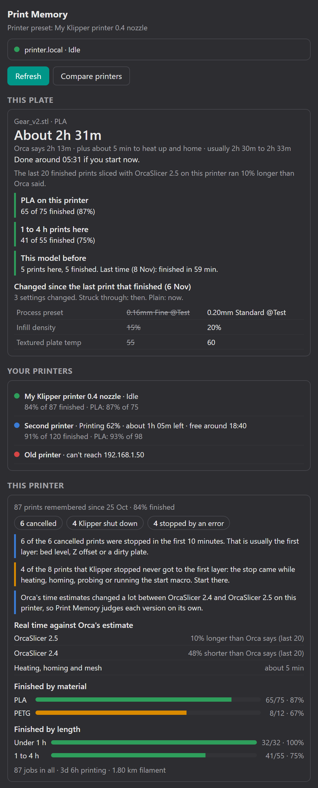
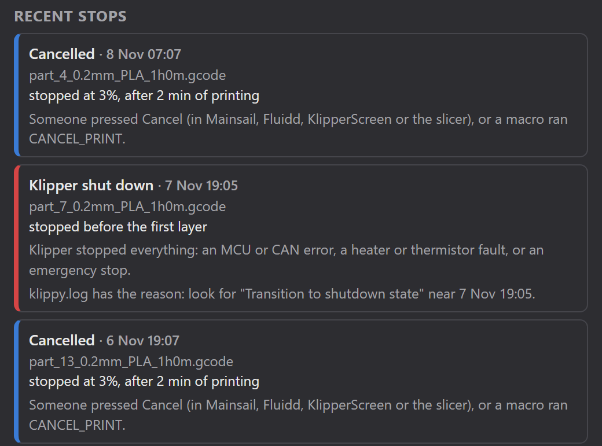

# Print Memory for OrcaSlicer

An OrcaSlicer 2.5 plugin that learns from your Klipper printer's print history.

Moonraker remembers every print: how long it really took, whether it finished, and how it
stopped if it didn't. Print Memory reads that history and answers the questions you ask yourself
right after slicing:

- **How long will this really take on this printer?** Orca's estimate, corrected by how far off
  it was on your last finished prints, plus the time the printer spends heating and homing.
- **Will it finish?** How often prints of this material, this length and this model finished
  on this printer before.
- **What did I change?** If the model was printed before, every setting that differs from the
  last print that finished.
- **Why did my last prints stop?** Each stopped print in plain words, how far it got, and what
  to look at next.

<p align="center"></p>

## What it shows

### This plate

Appears after you slice.

| Line | Where it comes from |
|---|---|
| **About 2h 31m** | Orca's estimate × how far off Orca was on the last 20 finished prints on this printer, sliced with the same OrcaSlicer version, plus the usual heating and homing time. The range under it is the middle half of those prints. |
| **Done around …** | Now + the forecast. If the printer is busy, the time left on the current print is added. |
| **PLA on this printer** | Finished prints / all prints with the same filament type. |
| **1 to 4 h prints here** | The same for prints of similar length (under 1 h, 1 to 4 h, 4 to 10 h, over 10 h). |
| **This model before** | Earlier prints of the same model, matched by file name, and how the last one went. |
| **Changed since the last print that finished** | Orca writes all settings at the end of every G-code file. Print Memory compares your new slice with the last finished print of the same model that is still on the printer. Ids, host settings and unused plate temperatures are left out. |

The time correction is kept separately for each OrcaSlicer version, because estimates change a
lot between versions. On one printer, G-code from Orca 2.4 ran in about half the estimated time,
while Orca 2.5 ran 10% over. Until 5 prints with your version have finished, Print Memory shows
Orca's own estimate and says so.

### Your printers

Click **Compare printers** to ask every printer preset that has a print host: is it free, how
often its prints finish, and how it does with the material you sliced.

### This printer

- Finished prints, and how the others stopped: cancelled, Klipper shut down, stopped by an
  error, printer computer restarted, and so on.
- Patterns worth knowing, for example:
  - most cancels happen in the first 10 minutes, which points to the first layer;
  - most Klipper stops happen before the first layer, which points to heating, homing,
    probing or the start macro rather than the print itself;
  - several prints stopped because the printer's computer restarted (power cut or reboot).
- Orca's error for each OrcaSlicer version, and how long heating, homing and meshing take.
- Finished rate by material and by print length.

### Recent stops

<p align="center"></p>

When Moonraker still has the console messages from that time, the error Klipper reported is
shown and explained, for example:

- `Heater extruder not heating at expected rate`
- `Timer too close`
- `Lost communication with MCU`
- `Move out of range`
- an emergency stop

Otherwise it tells you what to search for in `klippy.log`.

## Install

You need:

- OrcaSlicer 2.5 or newer;
- a Klipper printer with Moonraker and its print history turned on (the `[history]` section in
  `moonraker.conf`, which Mainsail, Fluidd and KIAUH setups already have).

**By hand:**

1. Download [`print_memory.py`](print_memory.py).
2. In OrcaSlicer, open **Plugins** from the main menu, click **Install plugin** and pick the file.
3. Tick **Activate** next to Print Memory.
4. OrcaSlicer asks whether Print Memory may read its temporary `orcaslicer_model` folder. Choose
   **Yes**. That is where Orca puts the G-code it just sliced, and the plugin reads it to see
   the estimate, material and settings.

## Use

1. Select your Klipper printer in Orca. Its print host (the Wi-Fi icon next to the printer
   name) must point at the printer, for example `192.168.1.50` or `printer.local:7125`.
2. Press **Space** to open the Speed Dial, type `Print Memory` and press Enter. You can also run
   it from the Plugins window. A panel opens beside the 3D view.
3. The first time, OrcaSlicer asks whether Print Memory may connect to the printer's address.
   Choose **Yes**. Orca remembers the answer.
4. Slice. **This plate** fills in by itself after every slice.

The panel also refreshes when you pick another printer preset or open another project.

## Privacy and safety

- Print Memory only sends HTTP `GET` requests, and only to the print hosts in your printer
  presets, or to the other address you typed for a printer:
  - `/server/history/list` and `/server/history/totals`;
  - `/printer/objects/query` for the print state;
  - `/server/gcode_store` for recent console messages;
  - `/server/files/metadata` for the file you are asked about;
  - the end of one G-code file: the last finished print of the same model, for the settings
    comparison.
- On your computer it reads only the G-code Orca just sliced, in Orca's temporary folder.
- It never sends G-code, never changes a printer, and never contacts anything else. Nothing
  leaves your network.
- If Moonraker needs an API key, Print Memory uses the one stored in the printer preset.

## Troubleshooting

**"Can't reach …"** The computer can't see the printer. Check that the printer is on and that
the print host address is right. If the printer can only be reached another way from this
computer, for example over Tailscale or a VPN, type that address in the box under the error and
press **Use**. Print Memory remembers it for this printer and leaves the preset as it is. It
also uses addresses you already typed into [Klipper Sync](https://github.com/ahmedbebars/klipper-sync).

**"refused the request (HTTP 401)"** Moonraker doesn't trust this computer. Add the computer's
network to `[authorization] trusted_clients` in `moonraker.conf`, or create an API key in
Moonraker and put it in the printer preset's print host settings.

**No print history.** Add a `[history]` section to `moonraker.conf` and restart Moonraker.
Prints are remembered from then on.

**"This model before" never shows up.** Models are matched by the start of the file name,
which Orca builds from the project or the first object's name. A file renamed by hand before
uploading can't be matched.

**"The G-code of the last good print is gone from the printer."** The settings comparison
needs that print's G-code. Moonraker keeps the history after a file is deleted, but not the
settings.

**This plate stays empty.** Slice again after activating the plugin, and make sure you answered
**Yes** to the folder prompt. If you said No, open Plugins → Print Memory → Permissions.

## Development

The analysis is plain Python and is tested without OrcaSlicer:

```
python -m unittest discover -s tests
```

`summarize_printer()` turns the data read from Moonraker into the printer report, and
`analyze_slice()` builds the "This plate" card from a parsed G-code. Everything that touches
OrcaSlicer lives in the `PrintMemory` class at the end of the file.

## License

GPL-3.0. See [LICENSE](LICENSE).
